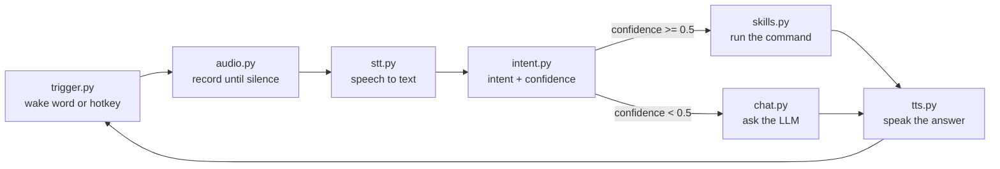

# VoiceBuddy

[](https://github.com/cavusbatuhan/VoiceBuddy/actions/workflows/tests.yml)

[](LICENSE)

A CPU-only Turkish desktop voice assistant for Windows, written in plain, readable Python.

*Türkçe: [README.tr.md](README.tr.md)*

Say "pusula", then a command in Turkish. VoiceBuddy opens apps and websites, tells the time and date, sets timers, reports the weather and, if you add an API key, chats about everything else.

## Features

| Feature | Runs | How |
|---|---|---|
| Wake word ("pusula") or a global hotkey (F9) | offline | `vosk`, small Turkish model / `keyboard` |
| Recording that stops when you stop talking | offline | `sounddevice` + a loudness (RMS) threshold |
| Speech to text | offline | `faster-whisper`, `base` model, int8 on CPU |
| Intent recognition with a confidence threshold | offline | TF-IDF on character n-grams + logistic regression |
| Skills: open apps and sites, time, date, timer | offline | a dictionary of plain functions |
| Weather | online | Open-Meteo, no API key |
| Spoken answer | online | `edge-tts`, Turkish neural voice |
| Chat for everything that is not a command | online, optional | Claude API (`claude-haiku-5-5`) |

Without internet the commands still run; the answer is then only printed, not spoken.

## Architecture

One loop, one file per stage, one main function per file.



| File | What it does |
|---|---|
| `main.py` | The loop above. |
| `voicebuddy/trigger.py` | Waits for the wake word or the hotkey, and notices when a timer ends. |
| `voicebuddy/audio.py` | Records from the microphone until one second of silence. |
| `voicebuddy/stt.py` | Turns the recording into Turkish text. |
| `voicebuddy/intent.py` | Decides which command the text means, and how sure it is. |
| `voicebuddy/skills.py` | The commands. Each one returns its answer as text, so it can be tested without a microphone. |
| `voicebuddy/chat.py` | Sends other sentences to Claude and remembers the last 10 messages. |
| `voicebuddy/tts.py` | Speaks the answer. |
| `voicebuddy/config.py` | Reads `config.toml`. |

## Technology choices

**Why two speech recognizers?** The wake word must be listened for all the time, so it needs a light model that works on a stream: Vosk. The command must be understood well, so it gets the more accurate model, which only runs after the wake word: faster-whisper.

**Why a classic classifier instead of an LLM for commands?** It is offline, answers in milliseconds, costs nothing, and gives a probability. A sentence below the threshold never runs a command, so "tell me a story" cannot open Excel by accident.

**Why character n-grams?** Turkish adds suffixes to words. "youtube'u", "youtubu" and "yutubu" share most of their letter pieces, so the model tolerates both suffixes and speech recognition mistakes.

**Why no thread for the timer?** A timer only writes down when it ends. The loop that waits for the wake word checks that list every 0.1 s. Only one place uses the microphone and the speakers, so nothing can talk over a recording and no lock is needed.

## Measured, not guessed

Measured on a Ryzen 5 7530U laptop (no GPU).

**Whisper model.** Five short Turkish commands in my own voice:

| Model | Average time | Correct words |
|---|---|---|
| `base` | 1.20 s | 11/14 |
| `small` | 3.85 s | 11/14 |

Same accuracy, `base` is about three times faster, so `base` is used. Repeat it with `python -m scripts.benchmark_stt`.

**Intent model.** 14 intents, 95 training sentences, 80 held-out test sentences (some are deliberately not commands): **84% correct (67/80)**. Repeat it with `python -m scripts.evaluate_intents`.

**Wake word.** The usual trick, allowing Vosk to answer only with the wake word, did not work with this model: it heard "pusula" in normal sentences too.

| Method | Wake word caught | False wake-ups |
|---|---|---|
| Wake word as the only allowed word | 4/4 | 10/10 other sentences |
| Free recognition, whole-word match | 14/14 | 0/44 |

The 44 negatives are 34 synthetic sentences and 10 recordings of my own voice. Synthetic voices are clean, so real rooms will be harder. Recognition takes about 9% of real time.

## Setup

Requires Windows and Python 3.12.

```
git clone https://github.com/cavusbatuhan/VoiceBuddy.git
cd VoiceBuddy
python -m venv .venv
.venv\Scripts\activate
pip install -r requirements.txt
```

1. **Wake word model.** Download `vosk-model-small-tr-0.3` from the [Vosk models page](https://alphacephei.com/vosk/models) and unzip it so that the files are in `models/vosk-tr/`. Not needed with `mode = "hotkey"`.
2. **Chat (optional).** Copy `.env.example` to `.env` and write your Anthropic API key in it. Without a key everything else works and unknown sentences get the answer "Bunu anlamadım."

The first run downloads the Whisper `base` model.

## Usage

```
python main.py
```

Say "pusula", wait for `Listening...`, say a command and stop talking. Press Ctrl+C or say "kapan" to quit.

| You say | What happens |
|---|---|
| "YouTube'u aç" | YouTube opens in the browser |
| "Hesap makinesini aç" | The calculator starts |
| "Saat kaç?" | "Saat 14:05." |
| "Bugün günlerden ne?" | "Bugün 16 Kasım 2026, Pazartesi." |
| "Beş dakikalık zamanlayıcı kur" | "5 dakika sonra haber veririm." and later "Süre doldu." |
| "Hava nasıl?" | "Viyana şu an açık, 12 derece." |
| "Türkiye'nin başkenti neresi?" | Claude answers (needs an API key) |
| "Kapan" | "Görüşürüz." and the program ends |

Settings are in `config.toml`:

| Setting | Meaning |
|---|---|
| `trigger.mode` | `"wake_word"` or `"hotkey"` |
| `trigger.wake_word` | One lowercase Turkish word the Vosk model knows |
| `trigger.hotkey` | The key for the hotkey mode, for example `"f9"` |
| `weather.city`, `latitude`, `longitude` | The place the weather is asked for |

Each part can be tried on its own:

```
python -m voicebuddy.tts "merhaba"
python -m voicebuddy.audio
python -m voicebuddy.stt recording.wav
python -m voicebuddy.intent "youtube'u aç"
python -m voicebuddy.trigger pusula
python -m voicebuddy.chat "Türkiye'nin başkenti neresi?"
```

## Adding a command

Opening another app or site needs no code. Add an entry to `data/intents.json`:

```json
"open_github": {
  "skill": "open",
  "target": "https://github.com",
  "answer": "GitHub açılıyor.",
  "examples": ["github'ı aç", "githubu aç", "github'a gir", "kodlarıma bak"]
}
```

For a new kind of command, write a function in `voicebuddy/skills.py` that takes `(intent, text)` and returns the answer as text, then add it to the `SKILLS` dictionary.

## Tests

```
pytest
```

The tests need no microphone, speakers or internet: the devices and the network are replaced by fakes.

## From v1 to v2

VoiceBuddy v1 (2023) was two separate programs. v2 is a rewrite from scratch.

| v1 | v2 |
|---|---|
| Two programs, one started the other as an exe | One loop |
| Functions called with `exec` | A dictionary of functions |
| API keys written in the code | `.env`, not in git |
| The best-scoring intent always ran | Confidence threshold |
| The assistant heard its own voice | The microphone is closed while it speaks |
| Fixed file paths | `config.toml` |
| No tests | `pytest` on every push |

## Known limits and next steps

- The spoken answer needs internet. An offline voice (Piper) is the next step.
- Some app commands score below the threshold ("Excel'i çalıştır") and are then treated as chat. More example sentences will fix this.
- Whisper `base` mishears some words ("Yutubu"); the intent model tolerates most of it.
- The interface is the terminal only.
- A timer that ends during a recording is announced after that turn.

The full plan, with the reasons behind each choice, is in [PLAN.md](PLAN.md) (in Turkish).

## License

[MIT](LICENSE)
