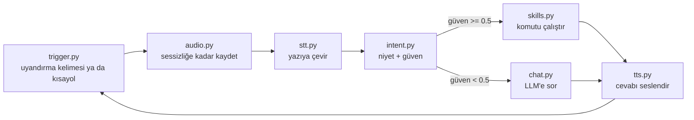

# VoiceBuddy

[](https://github.com/cavusbatuhan/VoiceBuddy/actions/workflows/tests.yml)

[](LICENSE)

Windows için, yalnızca işlemciyle çalışan, sade ve okunabilir Python ile yazılmış Türkçe masaüstü sesli asistan.

*English: [README.md](README.md)*

"Pusula" de, ardından Türkçe bir komut söyle. VoiceBuddy uygulama ve site açar, saati ve tarihi söyler, zamanlayıcı kurar, hava durumunu bildirir; bir API anahtarı eklersen geri kalan her şey hakkında sohbet eder.

## Özellikler

| Özellik | Çalışma | Nasıl |
|---|---|---|
| Uyandırma kelimesi ("pusula") ya da genel kısayol (F9) | çevrimdışı | `vosk`, küçük Türkçe model / `keyboard` |
| Sen susunca biten kayıt | çevrimdışı | `sounddevice` + ses seviyesi (RMS) eşiği |
| Konuşmayı yazıya çevirme | çevrimdışı | `faster-whisper`, `base` model, işlemcide int8 |
| Güven eşikli niyet (intent) tanıma | çevrimdışı | karakter n-gram TF-IDF + lojistik regresyon |
| Yetenekler: uygulama ve site açma, saat, tarih, zamanlayıcı | çevrimdışı | düz fonksiyonlardan oluşan bir sözlük |
| Hava durumu | çevrimiçi | Open-Meteo, API anahtarı gerekmez |
| Sesli cevap | çevrimiçi | `edge-tts`, Türkçe doğal ses |
| Komut olmayan her şey için sohbet | çevrimiçi, isteğe bağlı | Claude API (`claude-haiku-5-5`) |

İnternet yokken komutlar yine çalışır; cevap o zaman yalnızca ekrana yazılır, seslendirilmez.

## Mimari

Tek döngü, her aşama için tek dosya, her dosyada tek ana fonksiyon.



| Dosya | Ne yapar |
|---|---|
| `main.py` | Yukarıdaki döngü. |
| `voicebuddy/trigger.py` | Uyandırma kelimesini ya da kısayolu bekler, biten zamanlayıcıyı fark eder. |
| `voicebuddy/audio.py` | Bir saniyelik sessizliğe kadar mikrofondan kaydeder. |
| `voicebuddy/stt.py` | Kaydı Türkçe metne çevirir. |
| `voicebuddy/intent.py` | Metnin hangi komut olduğuna ve bundan ne kadar emin olduğuna karar verir. |
| `voicebuddy/skills.py` | Komutlar. Her biri cevabını metin olarak döndürür, böylece mikrofon olmadan test edilir. |
| `voicebuddy/chat.py` | Diğer cümleleri Claude'a gönderir, son 10 mesajı hatırlar. |
| `voicebuddy/tts.py` | Cevabı seslendirir. |
| `voicebuddy/config.py` | `config.toml` dosyasını okur. |

## Teknoloji seçimleri

**Neden iki konuşma tanıyıcı?** Uyandırma kelimesi sürekli dinlenir; bunun için akış halinde çalışan hafif bir model gerekir: Vosk. Komutun ise iyi anlaşılması gerekir; o yüzden daha isabetli olan ve yalnızca uyandırma kelimesinden sonra çalışan model kullanılır: faster-whisper.

**Komutlar için neden LLM değil de klasik sınıflandırıcı?** Çevrimdışı çalışır, milisaniyeler içinde cevap verir, ücretsizdir ve bir olasılık döndürür. Eşiğin altında kalan cümle hiçbir komutu çalıştırmaz; "bana bir hikâye anlat" yanlışlıkla Excel'i açamaz.

**Neden karakter n-gram?** Türkçe kelimelere ek getirir. "youtube'u", "youtubu" ve "yutubu" harf parçalarının çoğunu paylaşır; model hem ekleri hem de konuşma tanıma hatalarını tolere eder.

**Zamanlayıcı için neden thread yok?** Zamanlayıcı yalnızca ne zaman biteceğini bir listeye yazar. Uyandırma kelimesini bekleyen döngü bu listeye 0,1 saniyede bir bakar. Mikrofonu ve hoparlörü tek bir yer kullandığı için hiçbir şey kaydın üstüne konuşamaz ve kilit (lock) gerekmez.

## Tahmin değil, ölçüm

Ryzen 5 7530U işlemcili (ekran kartsız) dizüstünde ölçüldü.

**Whisper modeli.** Kendi sesimle beş kısa Türkçe komut:

| Model | Ortalama süre | Doğru kelime |
|---|---|---|
| `base` | 1,20 sn | 11/14 |
| `small` | 3,85 sn | 11/14 |

Doğruluk aynı, `base` yaklaşık üç kat hızlı; bu yüzden `base` kullanılıyor. Ölçümü `python -m scripts.benchmark_stt` ile tekrarlayabilirsin.

**Niyet modeli.** 14 niyet, 95 eğitim cümlesi, eğitimde görülmemiş 80 test cümlesi (bir kısmı bilerek komut değil): **%84 doğru (67/80)**. Ölçümü `python -m scripts.evaluate_intents` ile tekrarlayabilirsin.

**Uyandırma kelimesi.** Bilinen yöntem, yani Vosk'un yalnızca uyandırma kelimesiyle cevap vermesine izin vermek, bu modelde işe yaramadı: normal cümlelerde de "pusula" duydu.

| Yöntem | Yakalanan uyandırma | Yanlış uyanma |
|---|---|---|
| İzin verilen tek kelime uyandırma kelimesi | 4/4 | 10/10 başka cümle |
| Serbest tanıma, tam kelime eşleşmesi | 14/14 | 0/44 |

44 olumsuz örnek, 34 sentetik cümle ve kendi sesimle 10 kayıttan oluşuyor. Sentetik sesler temizdir, gerçek ortam daha zor olacaktır. Tanıma, ses süresinin yaklaşık %9'u kadar sürüyor.

## Kurulum

Windows ve Python 3.12 gerekir.

```
git clone https://github.com/cavusbatuhan/VoiceBuddy.git
cd VoiceBuddy
python -m venv .venv
.venv\Scripts\activate
pip install -r requirements.txt
```

1. **Uyandırma kelimesi modeli.** [Vosk modelleri sayfasından](https://alphacephei.com/vosk/models) `vosk-model-small-tr-0.3` dosyasını indir ve dosyalar `models/vosk-tr/` içinde olacak şekilde aç. `mode = "hotkey"` ile gerekmez.
2. **Sohbet (isteğe bağlı).** `.env.example` dosyasını `.env` adıyla kopyala ve Anthropic API anahtarını içine yaz. Anahtar yokken geri kalan her şey çalışır, bilinmeyen cümlelere "Bunu anlamadım." cevabı verilir.

İlk çalıştırmada Whisper `base` modeli indirilir.

## Kullanım

```
python main.py
```

"Pusula" de, `Listening...` yazısını bekle, komutu söyle ve sus. Çıkmak için Ctrl+C'ye bas ya da "kapan" de.

| Söylediğin | Olan |
|---|---|
| "YouTube'u aç" | YouTube tarayıcıda açılır |
| "Hesap makinesini aç" | Hesap makinesi başlar |
| "Saat kaç?" | "Saat 14:05." |
| "Bugün günlerden ne?" | "Bugün 16 Kasım 2026, Pazartesi." |
| "Beş dakikalık zamanlayıcı kur" | "5 dakika sonra haber veririm.", sonra "Süre doldu." |
| "Hava nasıl?" | "Viyana şu an açık, 12 derece." |
| "Türkiye'nin başkenti neresi?" | Claude cevaplar (API anahtarı gerekir) |
| "Kapan" | "Görüşürüz." der ve program biter |

Ayarlar `config.toml` dosyasında:

| Ayar | Anlamı |
|---|---|
| `trigger.mode` | `"wake_word"` ya da `"hotkey"` |
| `trigger.wake_word` | Vosk modelinin bildiği, küçük harfli tek bir Türkçe kelime |
| `trigger.hotkey` | Kısayol modunun tuşu, örneğin `"f9"` |
| `weather.city`, `latitude`, `longitude` | Hava durumunun sorulduğu yer |

Her parça tek başına denenebilir:

```
python -m voicebuddy.tts "merhaba"
python -m voicebuddy.audio
python -m voicebuddy.stt recording.wav
python -m voicebuddy.intent "youtube'u aç"
python -m voicebuddy.trigger pusula
python -m voicebuddy.chat "Türkiye'nin başkenti neresi?"
```

## Yeni komut ekleme

Başka bir uygulama ya da site açmak için kod gerekmez. `data/intents.json` dosyasına bir kayıt ekle:

```json
"open_github": {
  "skill": "open",
  "target": "https://github.com",
  "answer": "GitHub açılıyor.",
  "examples": ["github'ı aç", "githubu aç", "github'a gir", "kodlarıma bak"]
}
```

Yeni türde bir komut için `voicebuddy/skills.py` içine `(intent, text)` alan ve cevabı metin olarak döndüren bir fonksiyon yaz, sonra onu `SKILLS` sözlüğüne ekle.

## Testler

```
pytest
```

Testler mikrofon, hoparlör ya da internet gerektirmez: cihazların ve ağın yerine sahteleri konur.

## v1'den v2'ye

VoiceBuddy v1 (2023) birbirinden ayrı iki programdı. v2 sıfırdan yazıldı.

| v1 | v2 |
|---|---|
| İki program; biri diğerini exe olarak başlatıyordu | Tek döngü |
| Fonksiyonlar `exec` ile çağrılıyordu | Fonksiyon sözlüğü |
| API anahtarları kodun içindeydi | `.env`, git'e girmez |
| En yüksek puanlı niyet her zaman çalışıyordu | Güven eşiği |
| Asistan kendi sesini duyuyordu | Konuşurken mikrofon kapalı |
| Sabit dosya yolları | `config.toml` |
| Test yoktu | Her push'ta `pytest` |

## Bilinen sınırlar ve sonraki adımlar

- Sesli cevap internet ister. Sonraki adım çevrimdışı bir ses (Piper).
- Bazı uygulama komutları eşiğin altında kalıyor ("Excel'i çalıştır") ve o zaman sohbet sayılıyor. Daha fazla örnek cümle bunu düzeltir.
- Whisper `base` bazı kelimeleri yanlış duyuyor ("Yutubu"); niyet modeli çoğunu tolere ediyor.
- Arayüz yalnızca terminal.
- Kayıt sırasında biten zamanlayıcı o tur bitince söylenir.

Her seçimin gerekçesiyle birlikte tam plan [PLAN.md](PLAN.md) dosyasında.

## Lisans

[MIT](LICENSE)
